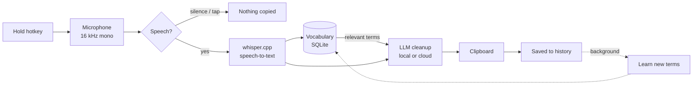

<p align="center">
  
</p>

<h1 align="center">Flight</h1>

<p align="center">
  <b>Private, local-first dictation for Windows that learns your vocabulary.</b><br>
  Hold a key, speak, let go: clean text is on your clipboard.
</p>

<p align="center">
  <a href="https://github.com/akhanrepo/flight-dictation/actions/workflows/ci.yml"></a>
  <a href="https://github.com/akhanrepo/flight-dictation/actions/workflows/codeql.yml"></a>
  <a href="https://github.com/akhanrepo/flight-dictation/releases/latest"></a>
  <a href="LICENSE"></a>
  
  
</p>

<p align="center">
  <a href="#install">Install</a> ·
  <a href="#using-flight">Usage</a> ·
  <a href="#how-it-works">How it works</a> ·
  <a href="#privacy">Privacy</a> ·
  <a href="#build-from-source">Build</a> ·
  <a href="docs/backlog.md">Backlog</a> ·
  <a href="CONTRIBUTING.md">Contributing</a>
</p>

> **Status: early (v0.2).** Flight works end to end, but it's young: expect rough edges, and expect settings and storage to change between versions. Bug reports with `timings.log` attached are the most useful thing you can send.

---

## Why Flight

Most dictation tools either send your voice to someone's server, or forget everything between sessions, so you correct the same client names and jargon every day. Flight does neither:

- **Everything runs on your machine by default.** Speech-to-text is [whisper.cpp](https://github.com/ggerganov/whisper.cpp) and cleanup is a small local LLM ([Phi-4-mini](https://huggingface.co/microsoft/Phi-4-mini-instruct) via [llama.cpp](https://github.com/ggerganov/llama.cpp)). It works offline and nothing leaves your computer.
- **It learns your vocabulary automatically.** Every dictation teaches it the names, products and terms you use, and later dictations spell them correctly. You never maintain a word list.
- **It stays out of your way.** A small pill shows while you speak, the text lands on your clipboard, and focus never leaves the app you're typing in.

## Features

| | |
|---|---|
| 🎙️ **Push-to-talk, anywhere** | Hold a key (Right Alt by default, or any key or combination you choose) in any app. |
| ✨ **AI cleanup** | Removes "um"s, false starts and repeats; fixes punctuation and grammar. A guard rejects output that adds words you didn't say. |
| 🧠 **Self-building vocabulary** | Learns terms from your dictations and feeds the relevant ones to the model next time. Stored locally in SQLite. |
| 🌍 **Translation** | Speak English, Urdu, Arabic, Spanish, French or Chinese; get text in any of the six. |
| 📋 **Straight to the clipboard** | No confirm dialog: release the key, then paste. |
| ☁️ **Optional cloud mode** | Bring your own key for any OpenAI-compatible endpoint (OpenAI, DeepSeek, Groq, …). The key is encrypted with Windows DPAPI. |
| ⚡ **Built for CPU-only laptops** | Models load in the background, short phrases skip the LLM, and per-stage timings are logged so you can see where the time goes. |

## Install

1. Download `FlightApp-win-Setup.exe` from the [latest release](https://github.com/akhanrepo/flight-dictation/releases/latest).
2. Run it. The build isn't code-signed yet, so Windows SmartScreen may warn you: choose **More info → Run anyway**.
3. On first launch Flight downloads its models (~2.5 GB: whisper base and Phi-4-mini) into `%LOCALAPPDATA%\Flight\models`. The pill shows the download progress.
4. Hold **Right Alt**, speak, release, and paste.

Flight lives in the notification area. Right-click its icon for Settings, Pause, Start with Windows, and Quit. Installed copies update themselves from GitHub Releases.

**Requirements:** Windows 10 1809+ or Windows 11, x64, ~4 GB free RAM for the local model. No GPU needed.

## Using Flight

| To… | Do this |
|---|---|
| Dictate | Hold the push-to-talk key, speak, release. When the pill shows a check mark, paste with Ctrl+V. |
| Change the key | Settings → **Push-to-talk key** → press the new key or combination. It applies straight away. |
| Translate | Settings → **Language**: set **I speak** and a different **Give me text in**. |
| Go faster | Settings → turn **AI cleanup** off: whisper plus rule-based tidying, no LLM. Translation still uses the model. |
| Use a cloud model | Settings → **Cleanup engine** → **Use the cloud model**, then paste a **Cloud API key** for any OpenAI-compatible endpoint. Only the transcript text is sent, never audio. |
| Pause | Right-click the tray icon → **Pause**. The hotkey does nothing until you resume. |

The pill shows what's happening: a red dot and live level bars while listening, a spinner while processing, a check when the text is on your clipboard. Release too quickly and nothing happens. If Flight hears only silence, it says **"Didn't catch that"** and leaves your clipboard alone.

## How it works



| Stage | Local default | Notes |
|---|---|---|
| Speech-to-text | whisper.cpp `ggml-base-q5_1` (multilingual) via [Whisper.net](https://github.com/sandrohanea/whisper.net) | The language is the one you choose, never auto-detected. |
| Cleanup / translation | Phi-4-mini-instruct Q4_K_M via [LLamaSharp](https://github.com/SciSharp/LLamaSharp) | One pass does both. Skipped for very short phrases or when AI cleanup is off. |
| Vocabulary | SQLite + trigram embeddings | Top-matching terms are injected into the cleanup prompt as spelling hints. |
| Cloud (optional) | Any OpenAI-compatible `/chat/completions` endpoint | Endpoint and model are configuration, not code. |

More detail in [docs/architecture.md](docs/architecture.md).

## Privacy

- **Local mode** (the default): audio, transcripts and vocabulary never leave your machine. The only network traffic is the one-time model download from Hugging Face and the update check against GitHub Releases.
- **Cloud mode** (opt-in): the transcript text, never the audio, is sent to the endpoint you configure, with your API key.
- Data lives in `%LOCALAPPDATA%\Flight`: `flight.db` (history, vocabulary, settings), `models\`, and `logs\` (errors and timings). Delete the folder to erase everything.
- No telemetry and no accounts.

## Troubleshooting

| Symptom | What to check |
|---|---|
| Always **"Didn't catch that"** | Flight records from the **default input device** in Windows Sound settings. Make sure that's the mic you're speaking into. Then open `%LOCALAPPDATA%\Flight\logs\timings.log`: each dictation has an `outcome` and a `peak` level. `outcome=silent` with `peak` below `0.005` means the mic is too quiet or the wrong one. |
| The first dictation after launch is slow | The models load in the background after startup. Give it a few seconds after launch, or check `timings.log` to see which stage is slow. |
| An error says the clipboard couldn't be written | Another app (a clipboard manager, another dictation tool) was holding the clipboard open. Try again. |
| Nothing happens and there's no tray icon | Check `%LOCALAPPDATA%\Flight\logs\errors.log`. |
| SmartScreen blocks the installer | The build isn't code-signed yet. Choose **More info → Run anyway**. |

Still stuck? [Open an issue](https://github.com/akhanrepo/flight-dictation/issues/new/choose) and attach both log files. `timings.log` holds only timings, outcomes and levels. `errors.log` holds error messages and stack traces, so skim it before posting.

## Configuration

Most settings are in the Settings window: push-to-talk key, AI cleanup, languages, and cloud mode with its API key. Advanced options are in `appsettings.json` next to `Flight.App.exe`, and can be overridden with `Flight__*` environment variables:

```json
{
  "Flight": {
    "CloudLlmEndpoint": "https://api.openai.com/v1/chat/completions",
    "CloudLlmModel": "gpt-4o-mini",
    "UpdateFeed": "https://github.com/akhanrepo/flight-dictation"
  }
}
```

Every option is documented in [`FlightOptions.cs`](src/Flight.Core/FlightOptions.cs).

## Build from source

```powershell
git clone https://github.com/akhanrepo/flight-dictation.git
cd flight-dictation
dotnet test Flight.slnx                 # all tests: no models, no network
dotnet run --project src/Flight.App     # the app (Windows only)
```

You need the .NET 8 SDK or newer. The app also needs Windows 10/11; the Windows App SDK comes from NuGet, so Visual Studio is optional (its "Windows application development" workload adds the XAML designer and debugger).

**On Linux or macOS** you can build and test everything except the WinUI shell:

```bash
dotnet test tests/Flight.Tests/Flight.Tests.csproj
```

Run `Flight.App --benchmark` to measure cleanup latency on your hardware (cold and warm). The results go to the clipboard and to `%LOCALAPPDATA%\Flight\benchmark-results.txt`.

## Project layout

```
src/Flight.Core/    All logic: dictation state machine, STT/LLM engines, vocabulary,
                    settings, hotkey matching, indicator view model. Cross-platform, fully tested.
src/Flight.App/     Thin WinUI 3 shell: windows, tray icon, keyboard hook, mic, clipboard.
tests/Flight.Tests/ xUnit tests mirroring src/Flight.Core. Fakes for every model and OS seam.
docs/               PRD, architecture, and a brief for every feature.
assets/brand/       Logo and icons, generated by make_logo.py.
```

## Roadmap

- [x] Push-to-talk dictation with local STT and LLM cleanup
- [x] Self-building vocabulary
- [x] Translation between six languages
- [x] Optional cloud mode (bring your own key)
- [x] Configurable hotkey, mini indicator, automatic copy
- [ ] Vocabulary biasing for speech-to-text (learned terms sent to whisper as hints)
- [ ] Spoken formatting ("new line", "comma", "open quote")
- [ ] Double-tap to lock (hands-free recording)
- [ ] Microphone picker in Settings
- [ ] Smaller default LLM option (Qwen2.5 1.5B / Llama 3.2 3B) after a quality A/B
- [ ] GPU (Vulkan) backend
- [ ] Code signing

The full list, with what's next, what's later and what's deliberately out of scope (and why), is in [docs/backlog.md](docs/backlog.md). Ideas and votes are welcome in [Discussions](https://github.com/akhanrepo/flight-dictation/discussions).

## Contributing

Contributions are welcome! Read [CONTRIBUTING.md](CONTRIBUTING.md) first: it covers the dev setup, the feature-brief process, and how tests are organised. Please also follow the [Code of Conduct](CODE_OF_CONDUCT.md). Report security issues privately as described in [SECURITY.md](SECURITY.md).

## Acknowledgements

Flight stands on [whisper.cpp](https://github.com/ggerganov/whisper.cpp) and [Whisper.net](https://github.com/sandrohanea/whisper.net), [llama.cpp](https://github.com/ggerganov/llama.cpp) and [LLamaSharp](https://github.com/SciSharp/LLamaSharp), Microsoft's [Phi-4-mini](https://huggingface.co/microsoft/Phi-4-mini-instruct), OpenAI's [Whisper](https://github.com/openai/whisper) models, [NAudio](https://github.com/naudio/NAudio), [Velopack](https://github.com/velopack/velopack) and the [Windows App SDK](https://github.com/microsoft/WindowsAppSDK). See [THIRD_PARTY_NOTICES.md](THIRD_PARTY_NOTICES.md).

## License

[MIT](LICENSE) © 2026 Ali Khan
