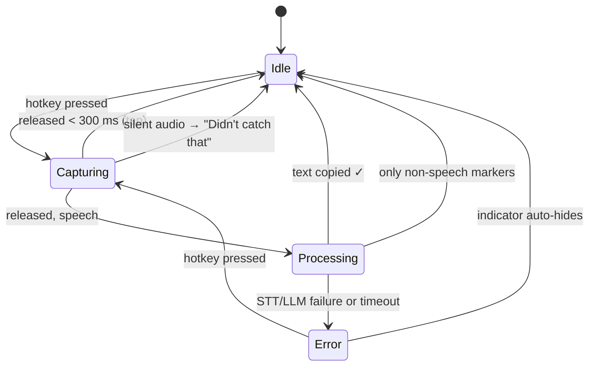

# Architecture

Flight is two projects and a test suite:

- **`Flight.Core`** (net8.0, cross-platform): every decision the app makes.
- **`Flight.App`** (WinUI 3, Windows only): a thin shell that renders Core's view models and forwards OS events.
- **`Flight.Tests`** (xUnit): tests Core through the same DI container the app uses, with fakes for every OS and model seam.

The split exists so that everything worth testing can be tested on any OS, with no UI harness, no models and no network.

## The dictation loop

`DictationOrchestrator` owns this state machine. On release it:

1. Snapshots `ISettingsStore.Current`, so a settings change mid-dictation applies to the *next* one.
2. Runs `SpeechGate` on the samples. A tap or silence never reaches a model.
3. Transcribes in the user's chosen language (`ISpeechToText`) and strips whisper's markers (`TranscriptFilter`).
4. Cleans and, if needed, translates in **one** LLM pass (`ITextCleaner` → `PromptTextCleaner`).
5. **Writes the clipboard, then persists the session, then enqueues vocabulary learning.** This is the only clipboard write in the app, and the order is deliberate: the text the user is waiting for is never behind I/O.
6. Records stage timings (`IDictationTimingsLog` → `logs/timings.log`).

Everything is bounded by `FlightOptions.ProcessingTimeout`, and Quit cancels an in-flight dictation without copying it.

## Seams

| Interface | Core implementation / role | Shell implementation |
|---|---|---|
| `IKeyboardHook` | `PushToTalkHotkey` matches the configured `Hotkey` and records new ones | `LowLevelKeyboardHook` (WH_KEYBOARD_LL) |
| `IAudioCapturer` | (consumed by the orchestrator, plus its level for the indicator) | `WasapiAudioCapturer` (NAudio, 16 kHz mono) |
| `ISpeechToText` | `WhisperSpeechToText` (Whisper.net) | — |
| `ILlmCompletion` | `LlmModeRouter` → `LlamaCompletion` (local) or `CloudLlmCompletion` | — |
| `IClipboardWriter` | — | `WindowsClipboardWriter` |
| `IDictationUi` | `ToastPresenter` → immutable `ToastView` | `DictationToastWindow` renders it |
| `ISecretStore` | — | `DpapiSecretStore` |
| `IAppUpdater` | `UpdateCheck` | `VelopackAppUpdater` |
| `IShellActions`, `IStartupRegistration` | `TrayPresenter` | `App`, `RegistryStartupRegistration` |

All of them are registered in `Flight.Core.Hosting.AppHost`. The shell adds its platform implementations; the tests add fakes from `tests/Flight.Tests/Fakes/Fakes.cs`.

## LLM routing

Three `ILlmCompletion`s exist, so DI tells them apart with wrapper types: `LocalLlmEngine`, `CloudLlmEngine`, and `LlmModeRouter` (the one everyone resolves). Each request carries its `LlmMode` from the per-dictation settings snapshot; background work follows the current setting. **There is no cloud→local fallback**: a cloud failure is an explicit error. Cloud is bring-your-own-key, and the endpoint and model are options, so switching provider is configuration.

## Vocabulary

- After each dictation, `BackgroundVocabularyLearningQueue` (a channel with a single worker) asks the LLM for terms (`LlmTermExtractor`), filters them (`VocabularyTermRules`), embeds them and upserts them into SQLite.
- The worker waits on `DictationActivity` while a dictation is capturing or processing, so learning never competes with the dictation the user is waiting on.
- Before cleanup, `VocabularyContextProvider` embeds the transcript and injects the top-K similar terms into the system prompt as spelling hints. `CleanupGuard` then rejects output that adds words the speaker didn't say.
- Embeddings are **character-trigram hashes** (`HashingEmbeddingGenerator`): instant, model-free, and lexical, which is what matching a misheard name needs. They're stored as float32 BLOBs and ranked by cosine similarity in `SqliteVocabularyRepository`.

## Performance

- `ModelWarmup` loads whisper, and the local LLM when in local mode, in the background at startup and on switching to local.
- `LlamaCompletion` sizes each request's context (prompt + output budget, rounded to 512, ≤ 4096) instead of allocating a 4096-token KV cache per call.
- `PromptTextCleaner` skips the LLM for phrases under four words, and whenever AI cleanup is off (unless translating).
- Thread counts come from `InferenceThreads` (about one per physical core, at most 8).
- Measure with `logs/timings.log` and `Flight.App --benchmark`.

## The indicator pill

`ToastPresenter` turns orchestrator calls into a `ToastView` (tone, title, text or icon-only, progress, auto-hide). `DictationToastWindow` only renders it:

- Sizes are **DIPs** (`ToastLayout`), converted per monitor. Never size windows in raw pixels.
- Placement (`ToastPlacement`) is bottom-centre by default; a dragged position is remembered (`JsonToastPositionStore`) and clamped back on screen.
- The window is `WS_EX_NOACTIVATE` and is always shown without activation, so focus never leaves the user's app.
- Microphone level arrives on a separate `LevelChanged` event (~20 Hz), so it doesn't trigger re-layout.

## Push-to-talk

`Hotkey` is a canonical set of virtual keys: side-neutral modifiers in combinations, side-specific for a lone modifier ("Right Alt"). `PushToTalkHotkey`:

- reads the hotkey from settings on every press (no restart), and releases on the hotkey that started the dictation;
- tolerates extra modifiers (AltGr layouts add a synthetic Left Ctrl) but not extra typing keys;
- swallows a non-modifier trigger key so it doesn't type, and swallows a key-up only if its key-down was swallowed;
- asks the hook to tap the 0xE8 "menu mask" key when the hotkey includes Alt or Win;
- records new hotkeys for Settings (peak combination, first key-up completes, Esc cancels).

## Storage

`%LOCALAPPDATA%\Flight\`:

| Path | Contents |
|---|---|
| `flight.db` | SQLite: `dictation_sessions`, `vocabulary_entries`, `settings` (one row) |
| `models\` | whisper and LLM weights, downloaded on first run |
| `logs\errors.log` | unhandled and startup exceptions; check it first when the app shows no window |
| `logs\timings.log` | per-dictation stage timings (last 200) |
| `toast-position.json` | where the indicator was dragged |

The schema is created by `FlightDatabase`. Columns added after a table shipped are added in place with `AddColumnIfMissing`.

## Packaging and updates

Velopack, unpackaged, self-contained win-x64. The pack id is `FlightApp`, not `Flight`, because uninstall deletes `%LOCALAPPDATA%\<packId>`, which would take the user's database and models with it. A `vX.Y.Z` tag publishes a GitHub Release, and installed copies update from it on exit. `Program.Main` runs Velopack's hooks before WinUI starts, and `SingleInstanceGate` keeps one copy per session.
